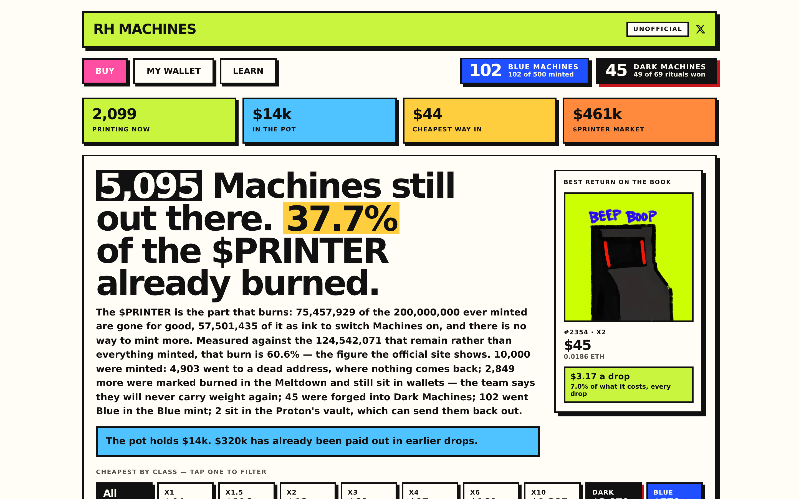
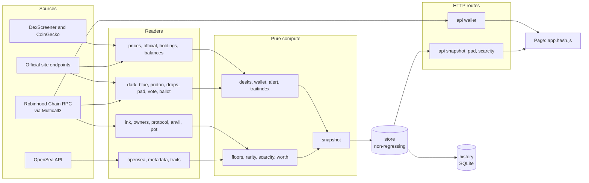

<div align="center">

# Unofficial RH MACHINES market dashboard

**What does each rarity class actually cost right now, and how deep is the market behind that price?**

[**rh-machines.sex**](https://rh-machines.sex) · [Source](https://github.com/Theroxat/rh-machines-dashboard) · [Protocol notes](docs/protocol.md) · [Deploy](DEPLOY.md)


-5a67d8)


</div>



> **This is not an official RH MACHINES tool.** It is an independent project, not
> built by, affiliated with, or endorsed by the RH MACHINES team, and nothing it
> shows is an official source. It is read-only: it holds no keys, signs nothing,
> places no orders, and gives no advice. Prices come from public OpenSea listings
> and public Robinhood Chain state, and can be wrong or stale — verify every price
> on OpenSea before buying.

A read-only dashboard for the [`rh-machines`](https://opensea.io/collection/rh-machines)
collection on Robinhood Chain. It answers one question: **what does each rarity
class actually cost right now, and how deep is the market behind that price?**

It never holds a private key, never signs a transaction, and never places an
order. It reads public marketplace listings and public chain state, computes
floors, and shows them. Every decision to buy is made by a person, off this tool.


## Contents

- [Highlights](#highlights)
- [Why every floor is split by ink](#why-every-floor-is-split-by-ink)
- [Quick start](#quick-start)
- [Architecture](#architecture)
- [HTTP API](#http-api)
- [The Meltdown, and the third state](#the-meltdown-and-the-third-state)
- [Dark Machines](#dark-machines)
- [Reading the grid](#reading-the-grid)
- [What the page will not do](#what-the-page-will-not-do)
- [Headwear is the rarity](#headwear-is-the-rarity)
- [One Machine the bulk pages drop](#one-machine-the-bulk-pages-drop)
- [Two tokens called USDG](#two-tokens-called-usdg)
- [Where the data comes from](#where-the-data-comes-from)
- [Security posture](#security-posture)
- [Caching, and why the script URL has a hash in it](#caching-and-why-the-script-url-has-a-hash-in-it)
- [Cadences](#cadences)
- [Design and plan](#design-and-plan)

## Highlights

| Market | Chain and protocol | Trust |
|---|---|---|
| Floors per rarity class **and** per ink state | Dark Machines and Blue Machines, one collection-level cell each | A provenance table naming the source of every number |
| Inked, dormant and burned cells on every row | Pot, desks and drops, with the protocol state read from `MINE` | A red banner, with age and error, when a sweep fails: stale and labelled beats fresh and wrong |
| Peloton: median of the five cheapest listings, or none | Destroyed Machines read on-chain (`0x…dEaD`) | Strict CSP, no inline script, no write path |
| Cost of ink in the header bar, priced from a pinned DEX pair | Wallet lookup, one multicall per request | OpenSea's own `floor_price` shown for comparison only |

## Why every floor is split by ink

A Machine is activated by burning $PRINTER into it — *ink*. Activation costs
5,000 $PRINTER: 4,250 burned as ink, 750 taken as an operating charge. Once
activated it is permanent. A dormant Machine earns nothing, cannot vote, and
receives no stock.

Measured on 2026-08-16, with $PRINTER at $0.0126 and ETH at $1,883, the
activation ink is worth **$53.72 ≈ 0.0285 ETH**, against a collection floor of
**0.0869 ETH ≈ $164**. The ink is roughly **a third of the price of a floor
Machine**.

So a single "floor of the x2 class" that mixes activated and dormant Machines
averages two assets separated by a third of their value, and the resulting number
describes neither. Every floor here is computed per class **and** per ink state,
or not at all.

## Quick start

```bash
npm test                      # 510 tests, ~2 s, no network, no .env needed
```

Create `.env` in the project root (gitignored, never committed):

```bash
OPENSEA_API_KEY=<your OpenSea API key>   # required: boot fails without it
# DISCORD_WEBHOOK=...                    # optional: absent means no alerts
```

Run it locally on Node 22 (`ethers` is the only runtime dependency):

```bash
npm install
set -a && . ./.env && set +a && npm start    # http://localhost:3050
```

Or with Docker:

```bash
docker compose up -d --build
```

The dashboard is at **http://192.168.0.11:3050**. The compose file publishes the
container's port only on the host's `192.168.0.11` address — it is not reachable
on `0.0.0.0`, and not on `localhost` from the host itself. (Without Docker, the
local run above listens on `localhost`.)

Two files persist under `./data`, both caching things that are sealed at mint and
never change, so there is no staleness risk. Delete either and the next boot
rebuilds it.

- `traits.json` — the 10,000 sealed rarities, read once from chain (about 20 s).
- `metadata.json` — each Machine's picture and traits, read once from OpenSea in
  50 calls (about a minute). Losing it costs the thumbnails and the headwear
  legend on the next boot until it is rebuilt; it costs no price and no floor.

See [`DEPLOY.md`](DEPLOY.md) for the bench-then-prod workflow and [`CLAUDE.md`](CLAUDE.md) for the code guide.

## Architecture

Readers do one thing against one source and report failure as failure. Pure modules
turn plain data into plain data. `server.js` is the only place that wires them and
touches the network.



The store keeps the last payload that actually computed: a failed sweep records its
error and leaves the data alone. History is written after serving, inside a
try/catch. Eight independent loops drive the readers; see [Cadences](#cadences).

## HTTP API

`GET` and `HEAD` only; anything else is `405`. Routes match on the URL path, so
`/?utm_source=x` is `/`. Every response, the 404 included, carries security headers.

| Route | Notes |
|---|---|
| `/`, `/index.html` | `no-cache`; carries the hashed script address |
| `/app.<hash>.js` | content-addressed, `immutable`, cached a year |
| `/app.js` | unversioned fallback, never cached |
| `/api/snapshot` | `no-cache` + ETag; `503` (never an empty `200`) until the first sweep lands |
| `/api/pad`, `/api/scarcity` | own routes because they move on 10-minute cadences, not the book's |
| `/api/wallet?address=` | the only route that reads the chain per request: one multicall, at most 8 in flight |

```bash
curl -s http://localhost:3050/api/snapshot | head -c 300
```

## The Meltdown, and the third state

On 2026-09-23 the team ran what it calls the **Meltdown**. Two different things
happened, and the page keeps them apart:

- **3,497 Machines went to the dead address** (`0x…dEaD`). 3,477 of them were
  the Proton's vault, which holders had filled themselves; its owner key sent
  them all out with `releaseMachine`. These are destroyed: out of every supply,
  out of every floor, and read **on-chain**, by owner.
- **4,381 Machines still in holders' wallets were marked burned.** Every Machine
  below 2x had its metadata rewritten off-chain: `Status: Burned`, a blood-red
  picture, a new headwear, `Weight (x): 0`. **No contract changed.** `MINE.weightOf`
  still gives them their weight and the official `totalWeight` still counts it;
  that they "will never carry weight again" is the team's statement, not
  something the chain enforces today.

So each row now has a third cell, **burned**, next to inked and dormant. A burned
Machine is still for sale, and still a Machine of its class, but it is neither
one that prints nor one you can switch on — mixing it into either floor would
drag that floor to the price of a Machine the team says will never earn. The
page shows no drop for it.

The collection floor and the market cap are computed on the living fleet only
(not destroyed, not marked burned). The burned floor is shown beside it.

The mark comes from metadata, so it is re-read every ten minutes from OpenSea.
Until it has been read once, the book is not computed at all: a page that waits
beats one that files burned Machines among the living. A Machine OpenSea does
not return is excluded and counted, never assumed alive. Only the picture and
the status are re-read — the traits used to derive rarity stay those of the
mint, and OpenSea no longer publishes the `Wallet`, `Desk` and `Weight` traits
the cache holds, so a full re-read would have erased them.

## Dark Machines

On 2026-09-23 the team opened the **Dark Ritual** (`0x207455FD…`). Four Machines
burned in the Meltdown go to the dead address and a fifth, the *vessel*, is
played on a hundred-spin slot. Win and the vessel becomes a **Dark Machine**;
lose and all five are gone. 60% success is claimed. The team says a Dark Machine
carries no weight but earns 10× on printer.fun and game revenue — an off-chain
promise nothing here measures.

Dark Machines are a fourth state with **one cell for the whole collection**, not
one per class: there are a few dozen of them, and splitting that by rarity would
leave every cell empty. A Machine is Dark when a ritual settled as won on-chain
(`Settled.won`), or when its published status says so. The two disagreed on day
one: #23 was published Dark with no ritual on chain. The Learn tab names such
Machines and puts the claimed and observed win rates side by side, as it does
for the Proton.

Dark Machines leave the living fleet like the burned ones, and never appear in
the best-return showcase.

## Reading the grid

Seven rows, one per rarity, each split into an **inked** half, a **dormant**
half and, since the Meltdown, a **burned** cell. A Machine is inked when its
`inkBurned` is above zero, unless its metadata marks it burned.

Each half shows that book as pictures, cheapest Machine first, with its price
and its `#id` under each. The cheapest one — the floor — is outlined, since that
is the price you can actually buy at right now.

A cell shows its **eight cheapest** and states how many it is holding back:
`+ 182 more`. Clicking that opens the whole book in place; clicking again closes
it. A cut book always says it is cut, so a partial view can never be mistaken for
a complete one, and an open cell stays open through the fifteen-second refresh.

Above the pictures, each half states two separate numbers — `183 on sale · 4,403
in this class`. They are deliberately not phrased as a ratio: `183 of 4,403
listed` read as "183 shown out of 4,403 available" and sent a reader hunting for
an expand button that had no reason to exist. How many are on sale is what gives
a floor its meaning — x6 at 0.70 ETH with 3 on sale is not the same market as 40
— and how many exist is what says whether the class is rare.

A cell with no button is already showing everything it has.

Hover a cell for its **peloton** — the median of its five cheapest listings, the
market level unmoved by a single dust or fat-finger listing — and its exact
listed share. Hover a Machine for its headwear.

The **cost of ink** sits in the header bar rather than in the table: it is the
premise of the whole inked/dormant split, and it is the same number for every
row.

## What the page will not do

A wrong dashboard is worse than no dashboard. These are enforced, not aspirational:

> [!IMPORTANT]
> **"No listing" is never `0`.** A floor of zero reads as the bargain of the century.
> The full list follows.

- **"No listing" is never `0`.** A floor of zero reads as the bargain of the century.
- **Fewer than five listings means no peloton at all.** The cell says how many it
  has instead. A median over two values must never be presented with the same
  authority as a median over five. The x6 and x10 classes hit this routinely —
  there are 81 and 37 of them in total.
- **An unreadable value is excluded and counted, never defaulted.** A rarity that
  failed to read does not silently become an x1. The footer states how many
  Machines were excluded and why.
- **A failed sweep never overwrites a good one.** The last valid snapshot stays on
  screen under a red banner naming its age and the error. Stale and labelled beats
  fresh and wrong.
- **OpenSea's published `floor_price` enters no computation.** On this chain it has
  been measured at roughly ten times the real book. It is displayed at the bottom,
  for comparison only.
- **The listings book is read to exhaustion or not at all.** A truncated book would
  silently move floors; the reader throws instead.
- **Listings are deduplicated by Machine.** The API returns the same token more
  than once; without dedup, listing counts and the peloton are inflated.

## Headwear is the rarity

Rarity is sealed on chain, but it is also written on the Machine's face: the
**Headwear** trait determines it exactly. And rarity is not decoration — payouts
are proportional to *weight*, which is rarity multiplied by the ink multiplier,
so a rarer Machine takes a proportionally larger share of every drop. Measured across all 10,000
Machines, 25 distinct headwear values each map to exactly one class, with no
ambiguity, and the resulting per-class counts reproduce the published census
(7,131 / 407 / 1,356 / 559 / 429 / 81 / 37) precisely.

| Rarity | Headwear |
|---|---|
| x10 | Blueberries |
| x6 | **None — no headwear at all** |
| x4 | Bitcoin Aura, Ordinals |
| x3 | All-Seeing Eye, Crown of Thorns |
| x2 | Beep Boop, Blade, Cursed Flame, Glitch Spark |
| x1.5 | Watcher Rings |
| x1 | Alert, Bad Day, Black Spikes, Blaze, Bowler, Confused, Devil Horns, Fez, Fire Mohawk, Green Mohawk, Halo, Ivory Horns, Smitten, Straw Hat |

The counter-intuitive one is x6: the second-rarest tier is the Machines wearing
**nothing at all**. Community weight lists circulating in Discord name six traits;
the collection has 25, and omits Blade, Glitch Spark, Beep Boop, Watcher Rings and
the bare-headed x6 tier entirely.

The page derives this table from the collection on every boot rather than
hard-coding it. A hard-coded table that went stale would keep displaying a wrong
mapping with full confidence; a derived one surfaces any headwear that starts
appearing in two classes, and files it under neither.

## One Machine the bulk pages drop

OpenSea's paginated NFT endpoint returned 9,999 of the 10,000 Machines: token
**#765** is absent from all 50 pages while answering perfectly on its own
endpoint. So after the bulk pass, anything still missing is fetched one by one
(bounded, so a real outage cannot turn into a hammering loop), and the cache is
rewritten. The backfill also runs against an accepted cache — otherwise a cache
written at 9,999 would sit just inside the tolerance and stay incomplete forever.

## Two tokens called USDG

Robinhood Chain carries two tokens with the symbol `USDG`. The canonical one,
quoted against $PRINTER and used by the protocol, is
`0x5fc5360D0400a0Fd4f2af552ADD042D716F1d168`. A second,
`0x63575aA902DE35ef2dc3a3D32355233bbb44CDa7`, sits in the deepest USDG/WETH pool
on the chain (~$110M) and prices ETH at **$1,786** against the canonical pool's
**$1,883** and CoinGecko's **$1,884** — 5% wrong, with no error anywhere.

> [!WARNING]
> The impostor sits in the deepest pool on the chain. Pools are pinned **by address**, never chosen by symbol or liquidity.

Selecting a pool by symbol or by liquidity lands on the impostor, and the ink
axis of this entire dashboard is scaled by that number. So the pair is pinned by
address, its `baseToken`/`quoteToken` addresses are verified on every read, and
USDG's own price must stay within 3% of $1 or the conversion is refused.

ETH is priced from the on-chain pool and cross-checked against CoinGecko. Both
values and the gap between them are displayed; a future divergence is
information, not something to average away.

## Where the data comes from

| What | Source |
|---|---|
| Listings | OpenSea v2, `/listings/collection/rh-machines/all`, cursor-paginated |
| Traits | OpenSea v2, `/chain/robinhood/contract/{addr}/nfts`, 200 per page, cached forever as minted |
| Current picture and burned mark | the same endpoint, re-read every 10 minutes |
| Destroyed Machines | `ownerOf` = `0x…dEaD`, via Multicall3 |
| Sealed rarity and desk | `TRAITS.weightOf` / `TRAITS.sectorOf` via Multicall3 |
| Ink | `MINE.inkBurned` via Multicall3, all 10,000 Machines |
| Protocol state | `MINE` — epoch, multiplier ceiling, total burned, active Machines |
| $PRINTER price | DexScreener, PRINTER/USDG on Uniswap v4 |
| ETH/USD | DexScreener, canonical USDG/WETH pool, cross-checked with CoinGecko |

Chain: Robinhood Chain, id 4663, RPC `https://rpc.mainnet.chain.robinhood.com`.

`weightOf` exists on two contracts and returns two different things: on TRAITS it
is the sealed class (100…1000), on MINE it is the effective weight including ink.
This dashboard reads the sealed class from TRAITS only.

## Security posture

<details>
<summary>Read the full security posture</summary>

The service holds no private key, signs nothing, and has no write path — only
`GET` and `HEAD` are answered (anything else is `405`), and routes are exact
matches on the URL path, so there is no file serving by path to traverse. The
OpenSea key is passed as an environment variable, never baked into the image, and
appears in no served route.

Beyond that:

- **The container runs as `node`, not root.** It reads from the network and
  writes two cache files; nothing about that needs uid 0.
- **The origin listens on the LAN address only** (`192.168.0.11:3050`), never on
  `0.0.0.0`. Public access is through the tunnel and nowhere else.
- **A strict CSP.** `default-src 'none'`, `script-src 'self'` with no
  `unsafe-inline` — possible because the page carries no inline script at all —
  images allowed from `i2c.seadn.io` and nowhere else, and `connect-src 'self'`.
  Any HTML injection that ever slipped through would still execute nothing.
- **`frame-ancestors 'none'` and `X-Frame-Options: DENY`.** This one is not
  boilerplate: the "unofficial" stamp protects nobody if the page can be framed
  inside a site that presents itself as official.
- **`Referrer-Policy: no-referrer`**, which also stops every thumbnail from
  telling OpenSea's CDN where the visitor came from.

What is *not* covered here: rate limiting, which belongs at the CDN rather than
in this process.

</details>

## Caching, and why the script URL has a hash in it

<details>
<summary>Read the full cache story</summary>

Behind a CDN, an origin that sends no cache headers does not get "no caching" —
it gets the CDN's defaults. Measured on 2026-08-16 behind Cloudflare: `/` and
`/api/snapshot` passed through as `DYNAMIC` while `/app.js` was cached for
**four hours**. A browser ended up running a script one version old against a
current snapshot. The new snapshot files pictures under `entries[]`; the old code
looked for them under `half.machine`, found nothing, and drew a silently wrong
table — no thumbnails, and a column that had been deleted. Nothing crashed and
nothing warned.

Asking a CDN not to cache is the weak fix. The script's URL is instead derived
from its content — `/app.<hash>.js` — so a changed script is a changed address
and no cache anywhere can serve the old one in its place. That asset is then
safe to cache for a year. The page itself carries `no-cache` so it always
revalidates and always hands out the current address, and `/api/snapshot` carries
`no-cache` with an ETag (below).

A deploy therefore needs no cache purge. `/app.js` without a hash is still served
for anything holding an old page, always uncached.

`/api/snapshot` carries `no-cache` and an ETag rather than `no-store`. Both force
revalidation on every request, so freshness is identical — but an ETag allows a
`304` with no body. The book changes once a minute and the page polls every
fifteen seconds, so three polls in four have nothing new to carry: 172 KB
becomes 0. At two hundred concurrent visitors that is the difference between
18.6 Mbit/s and a trickle.

This is why the response body no longer carries the snapshot's age. It changed
on every request, which would have changed the ETag on every request and made
the whole thing pointless. The page recomputes age from `at` and the response's
`Date` header — two server clocks, so a visitor whose own clock is wrong does
not see a phantom staleness warning.

</details>

## Cadences

Eight loops, each independent, each rescheduling itself only after it finishes:

| Loop | Every | What |
|---|---|---|
| book | 60 s | listings, prices, protocol state |
| ink | 10 min | ink and weight of all 10,000 Machines |
| owners | 10 min | who holds every Machine |
| status | 10 min | current picture and burned mark |
| dark | 2 min | Dark Ritual logs, read incrementally from the day it opened |
| blue | 2 min | Blue Machines handed out by the Blue contract |
| pad | 2 min | PRINTER.FUN coins |
| proton | 10 min | fusions and the vault |

Ink only changes when someone activates or re-inks, so it does not need the
book's rhythm and must never block the display. One loop failing leaves the
others running, and the page says what is stale.

## Design and plan

- Design: `docs/superpowers/specs/2026-08-16-rh-machines-market-dashboard-design.md`
- Implementation plan: `docs/superpowers/plans/2026-08-16-rh-machines-market-dashboard.md`
